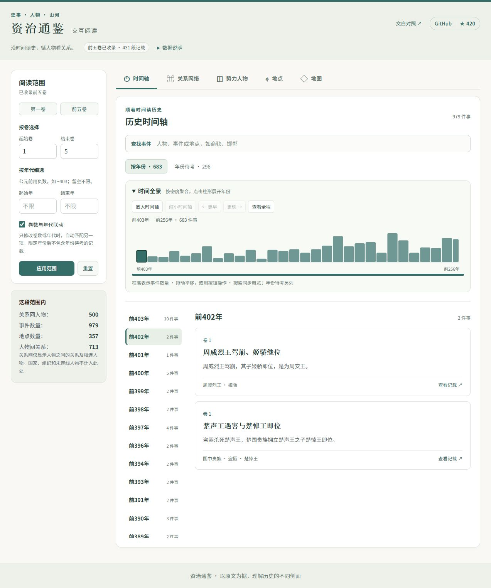
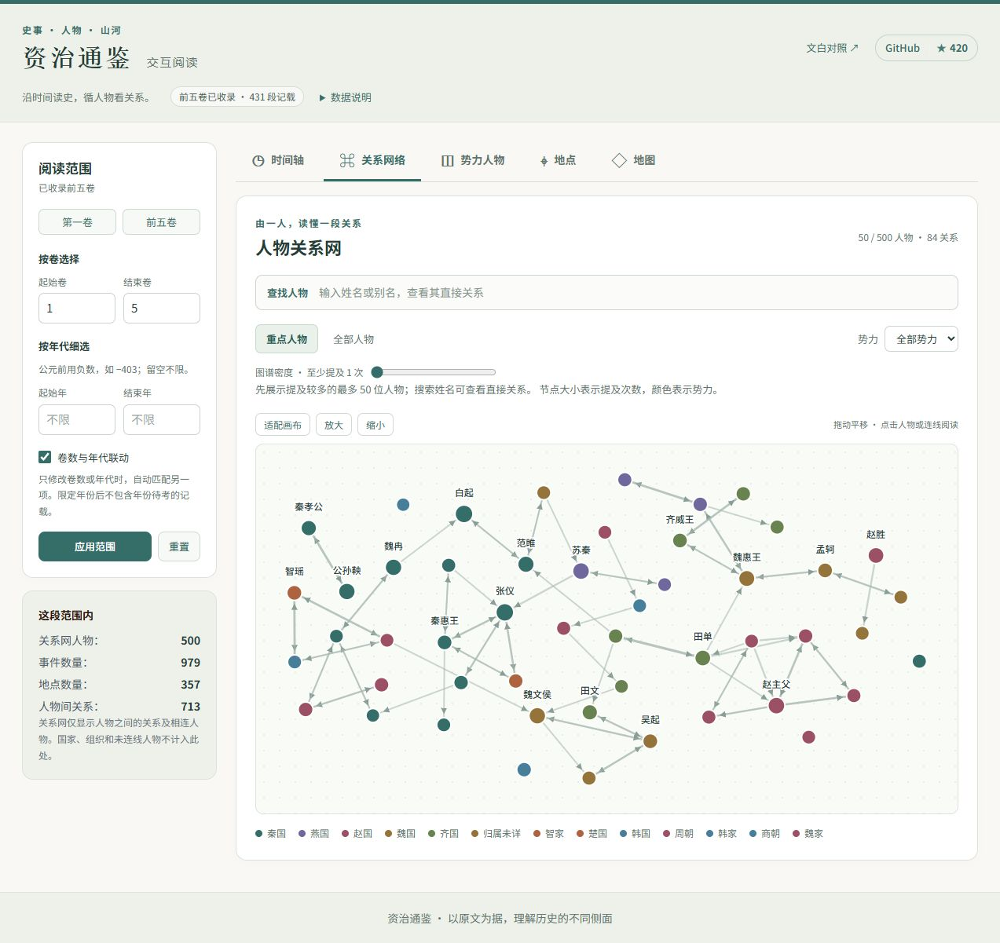
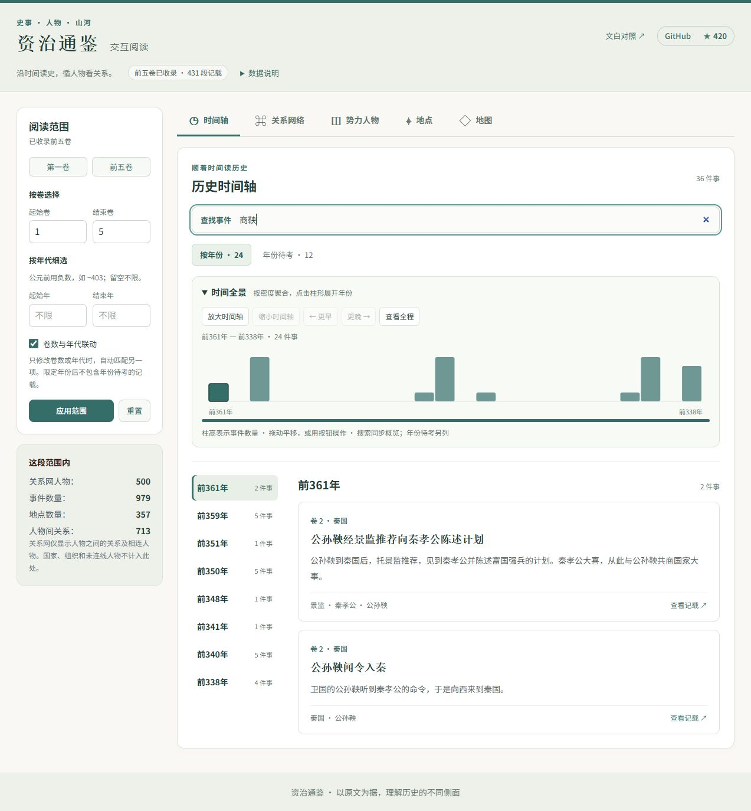
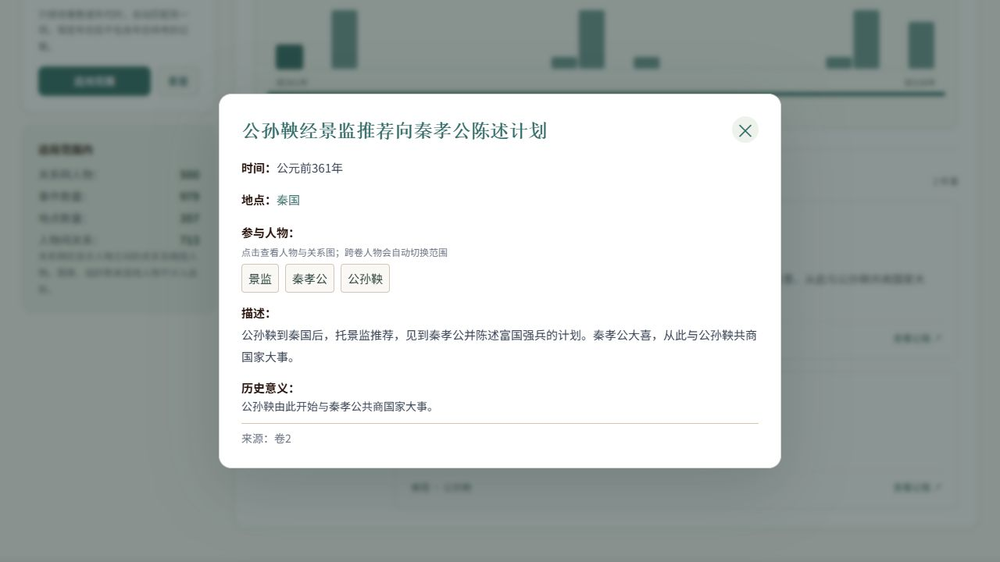
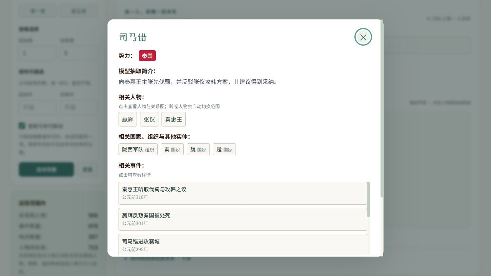
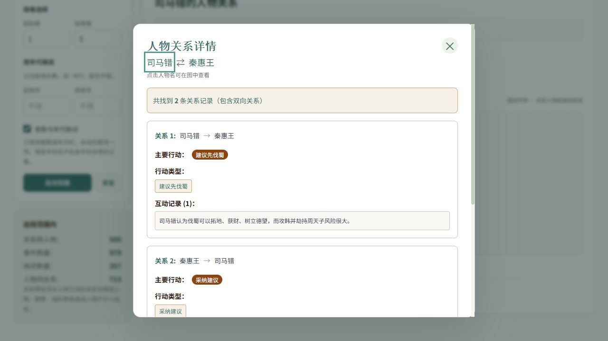
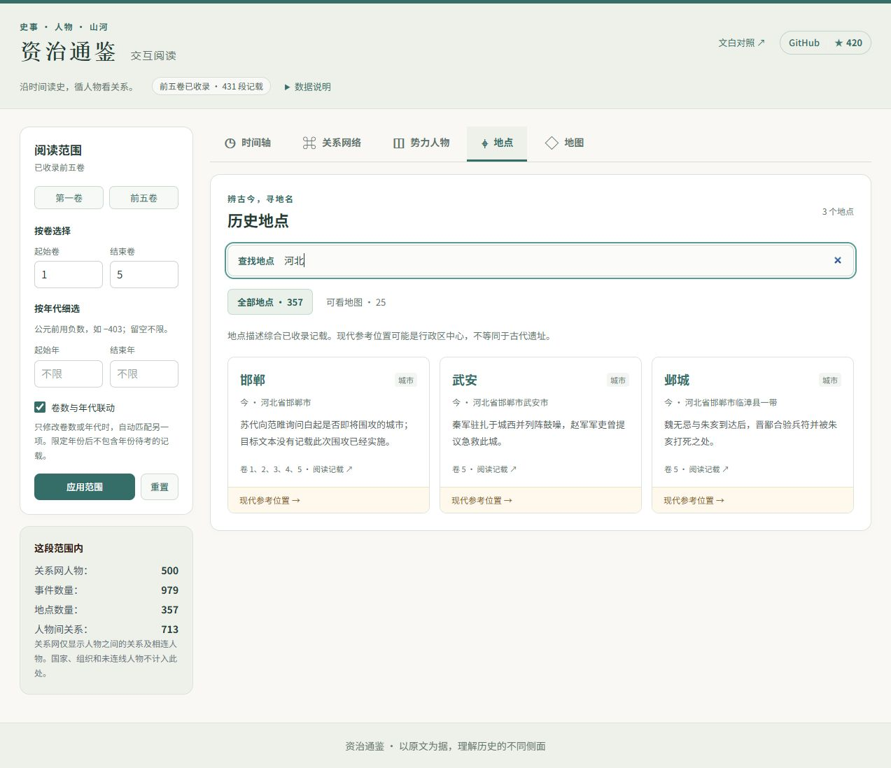
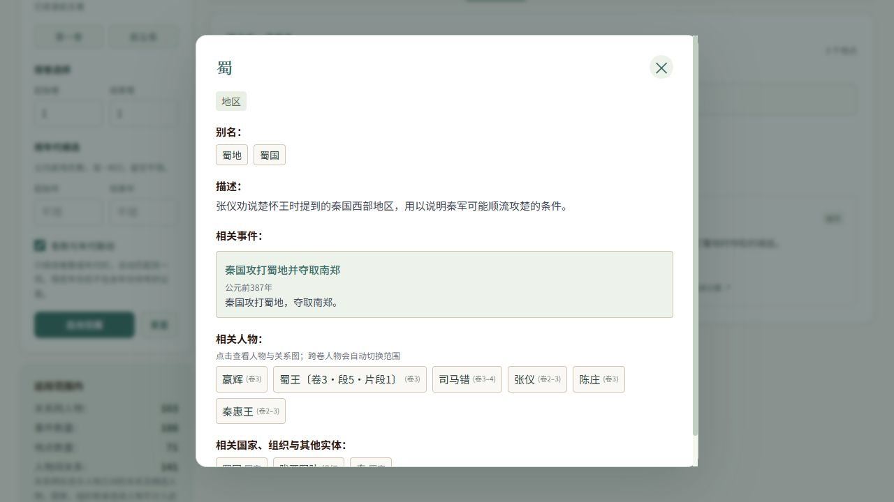
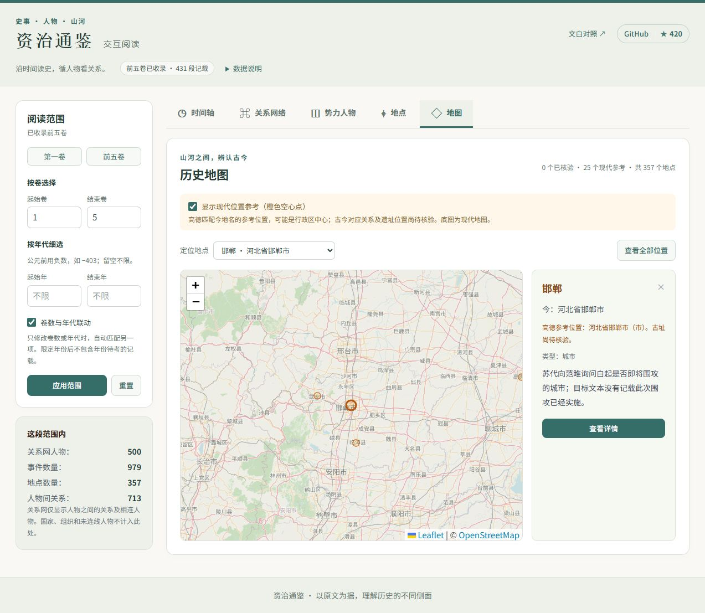
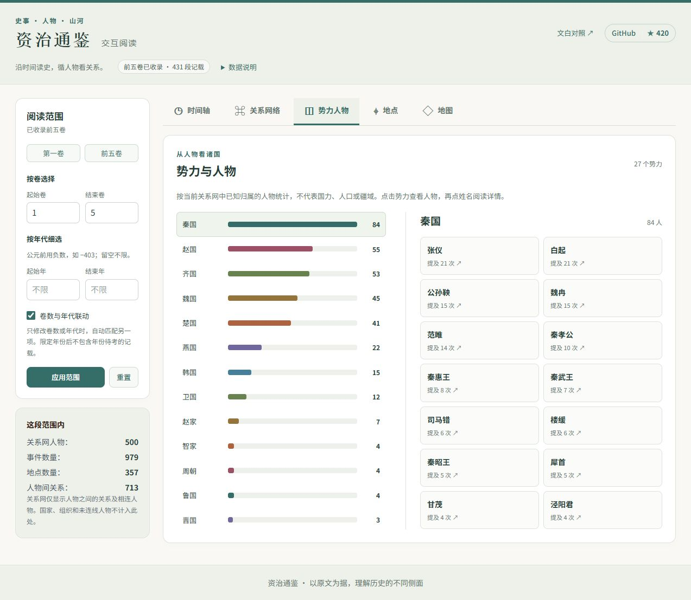

# 资治通鉴-文白对照数据-人工智能辅助理解-交互式史书

> 🚀 **在线体验：[资治通鉴交互探索](https://jy0284.github.io/zizhitongjian/explore/)**
>
> 已上线前五卷完整解析（431 段），支持时间轴、人物关系、地点与地图探索。
> [文白对照阅读](https://jy0284.github.io/zizhitongjian/)保留原有地址。

## 更新记录

- **2026.10.19（交互与视觉升级）**
    - 保留原有亮点，新增可折叠的事件密度概览；随视窗自动聚类，支持缩放、拖动与按钮平移、点击展开和别名搜索联动。
    - 关系网保留全景、拖拽、缩放和人物/连线详情，增加重点人物、直接关系聚焦、密度筛选、文字关系列表与键盘操作。
    - 五个视图统一视觉与移动布局；筛选先编辑再应用，详情支持 Escape、焦点恢复与跨卷返回。
    - 更新全部 9 张旧演示图，新增人物聚焦、势力人物和移动端 3 张实拍；[截图与功能核对](demo/showcase.md)记录复现步骤。

- **2026.10.18（前五卷上线）**
    - GitHub Pages 同时发布交互探索与文白对照阅读；无需内网转发或自建服务器。
    - GPT-6 Astra / high 与更严格的证据提示词，保留原文依据和模型版本。
    - 跨卷人物链接自动切换范围，支持别名与浏览器返回；国家、组织不再混入人物按钮。
    - 回溯旧事及相对日期不再被强行归到段落年份；未消歧称谓、使者及泛指群体按来源保留。
    - 人物原文依据附文言对照；五处译文缺字“孔”按原文“子思”修正派生展示。
    - 地点列表与详情可打开现代位置参考；参考点与已核验古址明确区分。

- **2026.1.17**
    - **前端可视化（visualization）**
        - URL 全局状态同步与历史语义（更稳定的跳转/回退体验）
        - 范围驱动视图（按卷/年份范围过滤事件、地点等），详情交互增强
        - 新增“地图”Tab（Leaflet + OpenStreetMap），地点可一键在地图中查看并高亮定位；地点列表支持搜索
        - 时间轴重构为“时间点列表 + 右侧事件列表”，更适配事件密集年份
        - 关系网络详情增强：人物详情/关系详情中展示“相关事件”，点击可直接打开事件卡片
        - 顶部增加 GitHub 入口与 Star 数展示（更方便关注/收藏）
        - 构建验证步骤补充（任务完成后可复现验证）
    - **数据与流水线**
        - 统一知识库与类型定义完善（canonical artifact / unified KB types）
        - 地点地理编码：高德(Amap)缓存与回填坐标流程
    - **工程化与文档**
        - 多处结构/可读性重构与健壮 JSON 解析复用
        - 任务地图与 UX 规范补充与更新；README 增加地图 Demo 截图

## 效果预览（当前版本）

以下均为 2026-10-19 使用仓库公开快照拍摄的真实界面；模型抽取结果仍需核对原文。

| 主界面（时间轴） | 核心能力：人物关系网 |
| --- | --- |
|  |  |

- **时间轴**：事件密集时自动聚类；支持缩放/平移/搜索
- **人物关系网**：点击人物/关系查看详情与交互事件（体现结构化的核心成果）
- **地点**：地点列表与详情，串起相关人物与事件；现代参考地图与古址核验状态分开显示
- **势力与移动阅读**：点击势力读成员，手机上折叠筛选、横向选年；保留文白对照和出处入口

## 文白对照阅读
[阅读书籍点击](https://jy0284.github.io/zizhitongjian/chapters/001_资治通鉴第一卷(周纪).html)

## GitHub Pages 部署

交互探索位于 `/zizhitongjian/explore/`，原有阅读页面及章节地址保持不变。浏览器直接读取公开 JSON，浏览时不调用模型或高德 API；地图使用 Leaflet 与 OpenStreetMap，当前坐标为现代位置参考，尚未核验为古址。

仓库的 **Settings → Pages → Source** 使用 **GitHub Actions**。提交到 `main` 后，[部署工作流](https://github.com/JY0284/zizhitongjian/actions/workflows/mdbook.yml)会校验公开数据、运行前端测试与构建，再合并 mdBook 阅读站点发布。也可以在 Actions 页面手动运行。

公开快照保存在 `visualization/snapshot/`。本地更新知识库后，在仓库根目录执行：

```shell
python scripts/export_public_snapshot.py
python scripts/validate_artifacts.py --data-dir visualization/snapshot
```

检查并提交这三个快照文件（两个数据 JSON 和 `manifest.json`）即可触发发布。导出器目前要求前五卷完整，扩展卷数时需同步调整覆盖范围校验。快照采用字段白名单并记录 SHA-256，构建时验证大小与校验值；模型密钥、高德 Key、费用账本和本地缓存不进入发布包。

新克隆仓库无需 API Key 即可预览已有快照：

```shell
python scripts/build_pages.py --install-snapshot
cd visualization
npm ci
npm run dev
```

复现完整发布包需 Node.js 22、Python 3.12 和 mdBook 0.4.36：先安装快照，以 `VITE_BASE_PATH=/zizhitongjian/explore/` 构建前端，再从仓库根目录运行 `python scripts/build_pages.py`。合并产物在 `.pages-build/site/`；工作流中包含完整命令。

## 现成数据下载（无需跑模型）

前五卷 431 段的公开快照已随仓库提交，也可直接下载：

| 文件 | 下载 | 仓库版本 |
| --- | --- | --- |
| `unified_knowledge.json` | [下载知识库](https://jy0284.github.io/zizhitongjian/explore/data/unified_knowledge.json) | [查看文件](https://github.com/JY0284/zizhitongjian/blob/main/visualization/snapshot/unified_knowledge.json) |
| `juan_year_index.json` | [下载卷年索引](https://jy0284.github.io/zizhitongjian/explore/data/juan_year_index.json) | [查看文件](https://github.com/JY0284/zizhitongjian/blob/main/visualization/snapshot/juan_year_index.json) |
| `manifest.json` | [下载覆盖范围与校验值](https://jy0284.github.io/zizhitongjian/explore/data/manifest.json) | [查看文件](https://github.com/JY0284/zizhitongjian/blob/main/visualization/snapshot/manifest.json) |

下载前两个文件，保持文件名不变，放入 `visualization/public/data/` 即可供前端使用。已克隆仓库时，优先运行 `python scripts/build_pages.py --install-snapshot`，它会校验后自动复制这三个文件，不需要 Python 第三方依赖或 API Key。模型结果仍需核对原文；这不是全书的结构化知识库。

## 供 Agent 使用的 Skill

[zizhitongjian-history](https://github.com/JY0284/zizhitongjian/blob/main/skills/zizhitongjian-history/SKILL.md) 提供全书文本检索、前五卷实体/事件检索、关系查询与文白对照出处。查询脚本只需 Python 3.11+，无需安装数据流水线依赖、运行模型或配置 Key。

```shell
python skills/zizhitongjian-history/scripts/query.py coverage
python skills/zizhitongjian-history/scripts/query.py search 陈庄 --kind entity
python skills/zizhitongjian-history/scripts/query.py neighbors 陈庄
python skills/zizhitongjian-history/scripts/query.py passage 3-11-4
```

Agent 可直接读取该 `SKILL.md`。若使用 Codex，也可把整个 `skills/zizhitongjian-history` 文件夹复制到 `$CODEX_HOME/skills/`（未设置时为 `~/.codex/skills/`），重新加载后用 `$zizhitongjian-history` 调用。复制安装后，查询时在子命令前添加 `--repo <克隆仓库的绝对路径>`；不要只复制 `SKILL.md` 而遗漏脚本。其他支持 `SKILL.md` 的 Agent 可按其技能目录约定安装。当前交付为 Skill 和本地 JSON 查询接口，不是 MCP 服务器。

## 简介
项目地址：[zizhitongjian](https://github.com/JY0284/zizhitongjian)

这个仓库是有关**资治通鉴-文白对照**的可供**人类和机器阅读**并进行**相关数据研究**的项目。

本项目中的文本格式按照原书的`卷`进行整理，`chapters`目录下按照`[0-9]+_资治通鉴卷名.md`进行分别存储：

```shell
chapters
├── 001_资治通鉴第一卷(周纪).md
├── 002_资治通鉴第二卷(周纪).md
├── 003_资治通鉴第三卷(周纪).md
...
```

每一卷的内容格式如下（`*`表示在部分卷中可能不存在的内容）：

```python
[卷名]*

[时间原文]
[时间译文]

[空白][空白][原文]
[空白][空白][译文]

[空白][空白][原文]
[空白][空白][译文]

[时间原文]
[时间译文]

[空白][空白][原文]
[空白][空白][译文]
```

## 结构化数据
结构化数据已由`model.py`生成，其中的数据结构及生成过程可见于`model.py`。结构化数据保存于`data.json`（[结构化数据文件](https://github.com/JY0284/zizhitongjian/blob/main/data.json)）。数据读取和使用样例请见`data_usage_demo_visualization.ipynb`（[结构化数据使用样例](https://github.com/JY0284/zizhitongjian/blob/main/data_usage_demo_visualization.ipynb)）。

## 资治通鉴数据应用样例：交互式历史可视化系统

本项目新增了基于 React + D3.js 的现代化交互式可视化系统，位于 `visualization` 目录下。该系统提供了更加流畅、直观的历史数据探索体验，帮助读者从时间、空间、人物关系等多个维度深入理解《资治通鉴》。

### 主要功能展示

#### 1. 交互式历史事件时间轴 (Interactive Timeline)
时间全景按视窗密度自动聚类，支持缩放、拖动或按钮平移；点击聚合柱展开年份，单年柱选择事件。概览下方保留逐年卡片阅读，搜索同时更新概览和列表，“商鞅”也可找到“公孙鞅”。年份待考单独列出，不混入确定年代。
- **主界面与时间轴概览**：

- **时间轴细节交互**：

- **事件详情与人物、地点入口**：


#### 2. 复杂人物关系网络 (Relation Network)
通过力导向图展示人物关系，保留拖拽、缩放、势力颜色与按提及次数调整的节点大小。默认展示最多 50 位重点人物，可切换全部人物、筛选势力或调整密度；搜索姓名聚焦直接关系。点击节点阅读人物，点击连线查看双向互动，节点与连线也支持 Enter/空格操作。
- **关系网络全景**：

- **人物聚焦（司马错）**：

- **人物详情查看**：

- **关系细节查看**：


#### 3. 历史地理与地点 (Historical Locations)
展示历史地名、今地名和相关事件，可搜索、查看详情，再跳转到人物或地图。跨卷人物会自动切换范围，浏览器返回可恢复原来的地点与卷数。地图当前有 25 个现代参考位置，尚无已核验古址；参考点不用于人物轨迹。
- **地点列表**：

- **地点详情**：

- **地图模式（OpenStreetMap）**：


#### 4. 势力人物与移动阅读

按已知归属展示关系网中的人物数量，点击势力查看成员，再点击姓名阅读详情；数量不代表国力、人口或疆域。手机上可折叠筛选与时间全景，横向选择年份，保留全部五个视图。




原有功能及新增交互的逐项核对、截图复现步骤见 [演示截图说明](demo/showcase.md)。

### 本地启动方法

环境要求：Python 3.11+（本地验证使用 3.12）、Node.js 22.13+。
干净克隆中包含 294 卷文本和前五卷已发布的模型抽取快照。
默认使用现成快照，不需要 uv、Python 第三方依赖或 API 密钥：

```bash
python scripts/build_pages.py --install-snapshot
cd visualization
npm ci
npm run dev -- --host 127.0.0.1
```

打开 <http://127.0.0.1:5173/>，默认展示前五卷，包含时间轴、关系网络、地点和现代位置参考。
只有需要开发或运行 Python 数据流水线时，才需在根目录运行 `uv sync --locked --python 3.12`。
Windows 上若 `uv` 未加入 PATH，可使用 `python -m uv`。

旧的 `scripts/prepare_demo.py` 仍用于最小样例调试；它不含完整事件和地图数据，
不应替代上述公开快照。样例卷号只是展示分组，不可用于历史研究。

## 本地开发

这个仓库主要分为两层：

1. 文本与数据流水线：Markdown 卷册、结构化书籍 JSON、抽取模型、数据产物构建脚本。
2. 可视化前端：位于 `visualization/`，读取 `visualization/public/data/` 中的运行时 JSON。

### Python 检查

```bash
uv run pytest -q
uv run python scripts/validate_segment_year_index.py --fail
```

### 前端检查

```bash
cd visualization
npm ci
npm test
npm run lint
npm run build
```

### 运行时数据

前端需要以下文件：

- `visualization/public/data/unified_knowledge.json`
- `visualization/public/data/juan_year_index.json`

这些运行时文件不纳入 Git。使用已发布的数据时，从 `visualization/snapshot/` 安装即可；
只有重新抽取或扩充数据时，才需要以下流水线。

### 构建正式数据

1. 将 `.env.sample` 复制为 `.env`，填写 `DEEPSEEK_API_KEY`，按实际可用模型设置 `DEEPSEEK_MODEL`。
2. 先查看待抽取范围，再运行小批量请求：

```bash
uv run python knowledge_extraction.py --dry-run --juan-start 1 --juan-end 1
uv run python knowledge_extraction.py --juan-start 1 --juan-end 1 --limit 5
uv run python scripts/build_data.py --publish-frontend
```

抽取命令会调用收费 API；默认仅处理 1 个未完成片段，默认 4 个工作线程，
单次请求超时 120 秒。可用 `--limit N` 限制批量，或显式使用 `--all` 处理
所选卷范围内的全部待处理片段。已保存片段会跳过，失败时命令返回非零退出码，
重跑可继续。请求并发执行，缓存由主线程串行保存。

全书原始分段共有 30,758 个句子片段；请先验证小批量质量再扩大范围。
`build_data.py --publish-frontend` 会验证并用正式产物替换前端样例。
需要地图坐标时，配置 `AMAP_KEY` 后加 `--geocode`。
仅重建年份索引可用 `uv run python scripts/build_data.py --skip-resolve`；
此命令不会凭空生成缺失的知识库。

### 本地模型配置与预算抽取

公开数据使用 **GPT-6 Astra / high** 和 `prompts/extraction_grounded_v2.md` 生成。模型抽取经过结构、覆盖和引用检查，仍需人工审校历史判断。

重新抽取时复制 `.env.sample` 为 `.env`，在本机填写 `LLM_API_KEY`、`LLM_BASE_URL`。具体服务接入、账户信息、单价和费用账本属于本地运行配置，不纳入仓库或发布包。

`scripts/run_budgeted_extraction.py --help` 列出完整选项。调用时显式指定模型、预算以及输入/输出每百万 token 的保守单价；`--dry-run` 只统计待处理片段，不发起请求。正式运行还要求 `LLM_PRICING_CONFIG` 指向本机审阅过的价格契约 JSON（放在被忽略的 `data/private/` 下），脚本核验接口、币种、计费规则和当前价格后才发送请求。

价格契约包含 `base_url`、`group`、`currency`（CNY）、`quota_per_unit`、`usd_exchange_rate`，以及 `models` 中各模型的 `billing_expression`、`input_base_rate`、`output_base_rate`。当前价格核验适配 `/api/pricing` 和 `/api/status` 格式；不同服务需实现相应适配，不能跳过价格检查。接口地址、账户分组和真实价格只填写在本地文件中。

请求先预留完整输出上限及保守输入费用，再按实际用量结算。网络异常或用量不明时保留全额预留、不自动重试；续跑必须沿用原账本。创建账本旁的同名 `.stop` 文件可停止后续请求。账本和响应保存在忽略目录 `data/runs/`，请勿上传。可选对账使用本机 `LLM_BILLING_LOG_URL` 和 `LLM_BILLING_UNITS_PER_CNY`，不会修改预算账本。

已完成的公开快照不需要这些配置。维护者可离线审计、重建自己的抽取缓存：

```shell
python scripts/audit_extraction.py --store-dir data/store-astra-v2 --model gpt-6-astra --juan-end 5
python -c "from pathlib import Path; from scripts.run_budgeted_extraction import publish; publish(Path('data/store-astra-v2'))"
```

`data/store-astra-v2` 是本地缓存路径，不随仓库分发。普通使用者运行前文的 `--install-snapshot` 即可。

原文修正仅影响派生展示；引用旧事不按叙述段落强行补年，尚未消歧的称谓按来源保留。同名地点的合并不代表古代疆界或坐标已核验。

地图底图使用 Leaflet + OpenStreetMap，浏览不需要 Key。仅在本地运行地理编码时配置 `AMAP_KEY`；现代地名匹配结果与已核验古址必须区分。

旧的 `knowledge_extraction.py` 入口使用 `DEEPSEEK_API_KEY` 与 `DEEPSEEK_MODEL`。所有密钥放在被忽略的 `.env` 中，进程环境变量优先，不要提交实际配置。

### 工程文档

- [UI 设计](docs/architecture/design.md)
- [数据流水线设计](docs/architecture/data_pipeline.md)
- [任务地图](docs/architecture/task_map.md)

## 技术实现简述

为了支撑上述可视化系统，本项目构建了一套完整的知识提取与融合流程：

1.  **AI 知识提取 (Knowledge Extraction)**
    *   利用大语言模型对《资治通鉴》原文进行深度语义分析。
    *   自动提取**人物 (Roles)**、**地点 (Locations)**、**事件 (Events)** 及**人物关系 (Relations)**。

2.  **实体消歧与融合 (Entity Resolution)**
    *   **智能合并**：通过 Union-Find 算法，将同一人物的不同称呼（如“赵籍”、“赵侯”）自动合并为统一实体。
    *   **防误触机制**：内置黑名单机制，防止“王”、“臣”、“公子”等通用称谓导致错误合并。
    *   **人地分离**：特殊处理逻辑区分人名与国名（如区分“赵籍”与“赵国”），确保关系网络准确性。

3.  **统一知识库 (Unified Knowledge Base)**
    *   将分散在各卷的碎片化信息重组为时空连贯的结构化数据，支持跨卷检索与分析。

4.  **地点地理编码 (Geocoding)**
    *   使用高德(Amap)为 `data/unified_knowledge.json` 的地点补全 WGS84 坐标（`coordinates: [lng, lat]`）。
    *   配置：复制 `.env.sample` 为 `.env`，填入 `AMAP_KEY`。
    *   运行：`python scripts/geocode_locations_amap.py` 生成候选缓存。即使高德只返回一个地址，也会标记 `needs_review=true` 并保留匹配地址、行政级别和候选坐标，避免把现代行政区中心误当成古址。
    *   核验后在缓存 `overrides` 中记录该地点的 WGS84 `coordinates: [经度, 纬度]` 和 `notes`（依据）；`python scripts/merge_geocoding_into_unified_kb.py` 回填已核验坐标。抽取脚本发布数据时也会自动合并缓存，保留人工核验结果。
    *   地图可显示匹配今地名的单一候选，使用橙色空心点标注“现代位置参考”。多候选、省级中心和未匹配今地名的结果不显示；候选不用于人物轨迹。
    *   速率控制：默认每次请求间隔 `0.25s`（可用 `--sleep` 调整），避免触发限流。
    *   无密钥也可预跑：不设置 `AMAP_KEY` 时会自动进入 `--simulate`（只写入 query/needs_review，不调用 API）。

## 项目进展

项目在持续更新，目前任务列表完成情况如下：
- [x] 文本内容获取
- [x] 格式化卷名，便于排序及查询
- [x] 时间数据的译文格式保持和原文格式统一
- [x] 去除不符合文白对照格式的空行、空格，使用统一的换行格式
- [x] 文本内容程序化校对，定位残缺和错误内容
- [x] 文本数据结构化，便于利用数据分析工具和可视化工具进行处理
- [x] 结构化数据使用样例
- [x] AI辅助理解及可视化样例
- [x] AI辅助知识图谱抽取流水线（人物、事件、关系与原文定位；支持全书处理，当前公开完整前五卷）
- [ ] 对话交互式资治通鉴
- [ ] ...

数据预处理的部分源码及说明在本项目的`*.ipynb`中存档及更新。

如果有任何感兴趣的、想要这个项目做的，请随时、尽情建议！

## 参与贡献

1. 请随时、尽情在issue中提供任何意见建议，不限于文本内容、文本格式、数据结构、数据分析、数据可视化等任何主题；
2. 文本中有`[todo]`的地方为分析过程中发现的内容残缺的部分，可以参与校对和修复:D

## 相关资源
1. http://www.ziyexing.com/files-5/zizhitongjian/zizhitongjian_index.htm
2. https://ctext.org/wiki.pl?if=gb&res=548761&remap=gb
3. 卷28译文可参考：http://www.ziyexing.com/files-4/yywj-157.htm


## Star History

[](https://star-history.dera.page/#JY0284/zizhitongjian&Date)
