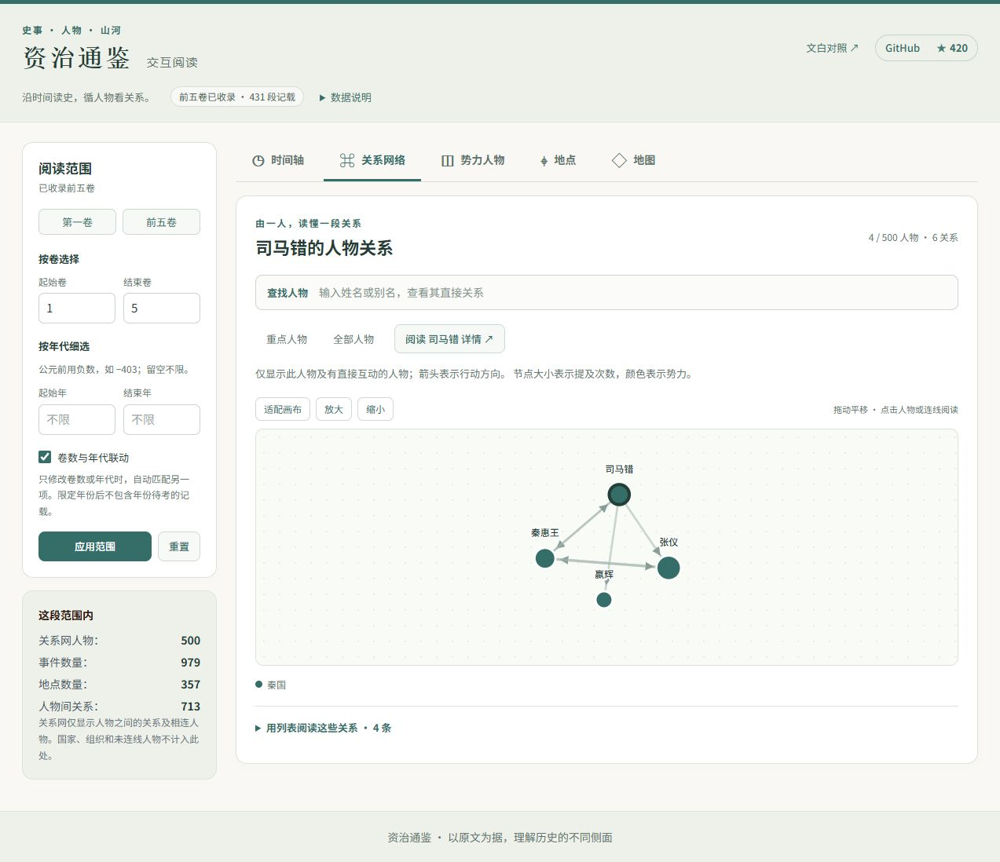

# 资治通鉴历史数据可视化系统

一个基于 React + TypeScript + Vite 构建的历史数据可视化系统，用于展示《资治通鉴》中的历史事件、人物关系和势力分布。

## 功能特性

### 📅 时间轴视图
- 展示历史事件按时间顺序排列
- 支持点击查看事件详情
- 事件密度全景自动聚类，支持缩放、拖动/按钮平移与点击展开
- 搜索同时过滤概览与事件卡片，支持人物别名；年份待考单列

### 🔗 人物关系网络图
- D3.js 力导向图展示人物间的互动关系
- 节点大小表示出现频率
- 颜色区分不同势力
- 支持拖拽交互、缩放与画布适配
- 重点/全部人物切换、势力和密度筛选，搜索后聚焦直接关系
- 人物节点与关系连线支持鼠标及 Enter/空格操作；关系另有文字列表
- 详情中的人物链接支持跨卷自动切换、别名解析与返回原筛选；国家与组织单独显示

### 📊 势力分布图
- 柱状图展示各势力的人物数量
- 点击势力查看成员，再打开人物详情；统计仅反映已知归属，不表示国力

### 📍 地点列表
- 展示所有出现的历史地点
- 包含古今地名对照
- “参考地图”打开高德匹配的现代位置，橙色空心点表示古址未核验，不用于人物轨迹

### 🎛️ 筛选功能
- **卷范围筛选**: 选择要查看的卷数范围（卷1到卷294）
- **时间范围筛选**: 按公元前年份筛选
- **快速筛选**: 预设的常用筛选条件

## 当前界面



[完整截图与功能核对](../demo/showcase.md)包含五个视图、详情导航和移动端实图。

## 技术栈

- **框架**: React 19 + TypeScript
- **构建工具**: Vite
- **样式**: Tailwind CSS
- **可视化**: D3.js
- **数据格式**: JSON

## 开发

先在仓库根目录运行 `python scripts/build_pages.py --install-snapshot`，再进入本目录。
这会校验并安装仓库已提交的前五卷完整快照，不需要 API Key、uv 或 Python 第三方依赖。
需要 Python 3.11+ 和 Node.js 22.13+。正式抽取和发布流程见根目录 README。

```bash
# 安装依赖
npm ci

# 启动开发服务器
npm run dev

# 回归检查
npm test
npm run lint

# 构建生产版本
npm run build

# 预览生产版本
npm run preview
```

## 数据结构

The current app reads unified runtime artifacts:

- `public/data/unified_knowledge.json`
- `public/data/juan_year_index.json`

缺少这些文件时，页面会提示加载失败。请在根目录运行 `python scripts/build_pages.py --install-snapshot`，
或按根目录 README 的“现成数据下载”链接下载前两个 JSON，放入上述目录。

维护者重新处理 Astra 抽取缓存时使用 `data/store-astra-v2`，具体命令见根目录 README。
该缓存仅保存在抽取机器上；普通使用者使用公开快照即可，不必重新跑模型。
旧 `prepare_demo.py` 仅提供最小关系网样例，默认 `data/store` 也不代表最新 Astra 结果。

`public/data/.gitkeep` 保留运行时目录；该目录的 JSON 不纳入 Git。对外版本存放于
`snapshot/`，由 `manifest.json` 记录覆盖范围与 SHA-256，并在部署时校验。

## 项目结构

```
src/
├── components/          # 可视化组件
│   ├── Timeline.tsx     # 时间轴组件
│   ├── TimelineOverview.tsx # 聚类概览与时间视窗
│   ├── NetworkGraph.tsx # 关系网络图
│   ├── PowerChart.tsx   # 势力分布图
│   ├── FilterControls.tsx # 筛选控件
│   └── DetailPanels.tsx # 详情面板
├── hooks/
│   └── useUnifiedData.ts       # 数据加载 Hook
├── types/
│   └── unified.ts         # TypeScript 类型定义
├── utils/
│   ├── unifiedDataProcessing.ts # 数据派生与范围过滤
│   └── exploration.ts   # 搜索、聚类与密度筛选
├── App.tsx              # 主应用组件
└── main.tsx             # 入口文件
```

## 许可证

MIT
